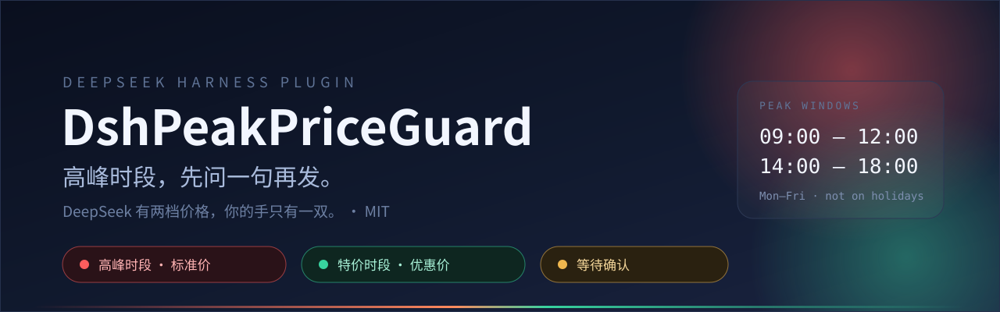

<p align="center">
  
</p>

<p align="center">
  <a href="./LICENSE"></a>
  <a href="https://www.npmjs.com/package/dsh-peak-price-guard"></a>
  
  <a href="https://github.com/nowscott/DshPeakPriceGuard/actions/workflows/test.yml"></a>
  
</p>

<p align="center"><i>DeepSeek has two prices. You have one pair of hands.</i></p>

<p align="center"><a href="./README.md">中文</a> · English</p>

---

A plugin for DeepSeek Harness. During **peak (standard-price) hours** it holds your hand
back from the send key for half a second: it asks "send this now?", and only sends after you
say yes. Off-peak it disappears entirely and never interrupts.

## What it does

| You do this | It does that |
| --- | --- |
| Press send during peak hours | Nothing leaves the composer; a card states the time, the message length, the session, and when discount pricing resumes |
| Choose "Send anyway" | Sent exactly as you typed it |
| Choose "Don't send" / Esc / click the mask | Draft and attachments return to the composer, **with no error notice** (so you don't think you broke something) |
| Press send off-peak | Straight through; the plugin may as well not exist |
| See the small pill under the composer | Red = peak, green = off-peak, amber = waiting for your answer, red "inactive" = the upstream interface changed; check Settings |

The pill can be switched off. With it off the guard still holds sends; it just stops telling
you so — which is why leaving it on is the better default.

## How the price calendar is computed

Beijing time, **Monday to Friday**, `09:00–12:00` and `14:00–18:00` bill at the standard
price. Everything else is off-peak: evenings, nights, weekends, public holidays, and the days
you assumed were working days but were not.

The windows are editable in Settings, in any of these shapes: `09:00-12:00, 14:00-18:00`,
`9-12`, `00:00-24:00` (the last one is for testing, so you don't have to wait until 9 a.m.).

## Holidays: looked up, never memorized

Next year's holiday schedule is published in November or December, so any holiday table
compiled into a release is wrong by some New Year's Day. This plugin does not memorize
holidays; it looks them up:

1. **Online**: on startup it fetches the current and next year from
   [holiday-cn](https://github.com/NateScarlet/holiday-cn) (MIT), which re-scrapes the State
   Council notices daily.
2. **Cached**: the fetched table lives in a cookie for 45 days, so an offline launch does not
   mistake a holiday for a billable workday.
3. **Built in**: a 2025–2026 table answers only for a year neither of the first two layers
   covers.

Once a year's data arrives, that year follows it — a corrected notice reaches the plugin
without a new release.

The bottom of the Settings page says which layer answered and when it last updated, next to a
**Refresh now** button. A failed fetch is not papered over: the status line turns amber and
the plugin retries in 30 minutes (then every 12 hours after a success). The cache is compact —
each year stores its prefix once — so two years still fit in a single cookie.

## A few deliberate choices

- **The dialog is accessible**: `role="dialog"` with `aria-modal`, a labelled title and
  description, Esc to cancel, focus on "Don't send" when it opens, and Tab cycling inside the
  dialog instead of escaping to the composer behind it.
- **The gate waits for its hook**: when the send method has not been assembled yet at mount,
  it retries with 0.4s→6.4s backoff instead of giving up for the whole session over a load
  order.
- **An installed gate keeps checking**: every 15 seconds it reads the send method back. If the
  upstream replaced it — a client-side hot reload rebuilds the service, for example — it wraps
  the new method; only a patch that genuinely cannot be reached turns the pill red. Checking
  once at mount is not enough: the hours a page sits open are exactly when silent failure
  happens.
- **Failure is loud**: when the interface changes, the pill turns red and Settings shows a
  banner. Failing quietly is worse than failing visibly.

## Where the preferences live

Peak windows, switches, and the silence window live in the **plugin configuration** (the
profile's `cordis.patch.yml`), so they survive a different browser, a different machine, or a
cleared cookie jar. One line at the bottom of Settings says which is true right now:

| That line says | It means |
| --- | --- |
| Preferences are stored in the plugin configuration (cordis.patch.yml) | Normal: the file holds them |
| Saved to the plugin configuration | Just written |
| Saving to the plugin configuration… | In flight (rapid edits coalesce into one write) |
| The plugin configuration cannot be written / writing failed | Fallen back to this browser; the UI works, and your edits survive the next launch |

There is no magic in it: the Host half publishes the row config to the page as one boot global
through the web server's index injection, and the Settings page POSTs changes to a same-origin
route that persists them through `configEditor` — which **writes configuration** rather than
rewriting your `cordis.patch.yml` by hand, keeping comments and `!!js` expressions intact. The
route requires a private header and checks `Origin`, so another website cannot change your
preferences from the browser.

Without a web server, or when the profile does not mount `config-editor`, that path simply
does not exist; the plugin falls back to its cookie and loses no functionality.

## Install

Install it from **Settings → Plugins** in DSH, or have the agent run:

```
plugin_manager install_bundle dsh-peak-price-guard
```

For development, install the directory as a link so edits to `client.js` take effect after a
page refresh (no reinstall):

```
plugin_manager install_bundle link:<absolute path to this directory>
```

> The Host half (`index.js`) is a Node module, not a browser asset; a linked directory only
> hot-reloads the Client half. After changing `index.js`, restart the app.

## Development and verification

Changes go through a pull request; `main` is protected:

```bash
git switch -c fix/holiday-retry
# edit, bump the version
npm test                       # 45 checks
node scripts/check.mjs         # packaging / dictionary / default-config drift
git push -u origin HEAD
gh pr create --fill            # merge once CI is green on both Node versions
```

`main` requires a PR, both `node 22` and `node 24` checks, and a linear history (squash merge).
Merging decides **whether** to release; the tag decides **when**.

Coverage: window boundaries, holiday replacement and fallback, the compact cache and its
back-compat, the next peak window, window parsing, preference normalization, the send gate and
its mount retry, the runtime re-check (re-wrapping a replaced method), session silence, FIFO,
abort, dialog hook order and accessibility attributes, Tab trapping, Settings copy, pill
states, cookie persistence, config-file seeding and write-back, a refused write keeping the
browser copy authoritative, and the Host route's auth and size limits.

The two halves are tested differently: the `client.js` cases run the real bundle through
`window.__ModuleLoader__` plus a minimal React stub, and the `index.js` cases call `apply()`
with a fake context and inspect the route it registers.

## Honest list

- **It depends on an internal interface**: `conversation.sendSession`. That is not an official
  extension point; an upstream rename would silently disable the guard — which is why the
  plugin checks the patch at runtime, re-wraps a replaced method, and turns red rather than
  pretending.
- Only **human sends** are gated. Programmatic prompts such as scheduled jobs are not — nobody
  can confirm them on the agent's behalf.
- `updateQueue(steer)` re-sends a message that was already queued and already asked about. The
  one seam: queue it off-peak, steer it during peak; billing follows the request time and no
  question is asked.
- Holidays depend on a third-party repository and a CDN. If both are down and the cache has
  expired, the built-in table answers, and a newly announced year may be misjudged.
- **Config-file preferences need the Host half**, which leans on three more internal pieces:
  the web server's index injection, the `configEditor` service, and the route this plugin
  registers itself. If any is renamed or removed, the plugin falls back to cookies and says so
  in Settings — same class of risk as `sendSession`.
- A settings write replaces the **whole** config (that is `configEditor`'s contract), not
  individual keys. Unknown keys are preserved, though their order may change.

## Release

The version number goes through a pull request too — `main` is protected, so the
"`npm version` and push to main" habit is rejected.

```bash
git switch -c release/0.5.1
npm version 0.5.1 --no-git-tag-version
git commit -am "chore: release 0.5.1"
git push -u origin HEAD
gh pr create --fill && gh pr merge --squash --delete-branch
git switch main && git pull

git tag -a v0.5.1 -m "v0.5.1" && git push origin v0.5.1
```

The tag hands off to `publish.yml`: run the checks → exchange a GitHub OIDC token for a short
npm credential → publish → `gh release create --generate-notes`. There is **no `NPM_TOKEN`**;
npm trusted publishing is registered once (Provider = GitHub Actions,
repo = `nowscott/DshPeakPriceGuard`, workflow = `publish.yml`).

`package.json` is the only version source; the README badge is npm's dynamic badge.

## Handover

The design decisions, the release plumbing, and the mistakes worth remembering are in
[docs/handover.md](./docs/handover.md).

## License

[MIT](./LICENSE).

Holiday data comes from [NateScarlet/holiday-cn](https://github.com/NateScarlet/holiday-cn)
(MIT), generated by its CI from the State Council notices.

<p align="center"><sub>This plugin does not produce tokens; it just guards the door.</sub></p>
