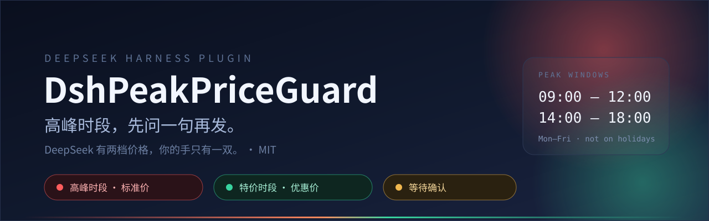

<p align="center">
  
</p>

<p align="center">
  <a href="./LICENSE"></a>
  <a href="https://www.npmjs.com/package/dsh-peak-price-guard"></a>
  
  <a href="https://github.com/nowscott/DshPeakPriceGuard/actions/workflows/test.yml"></a>
  
  
</p>

<p align="center"><i>DeepSeek 有两档价格，你的手只有一双。</i></p>

---

一个 DeepSeek Harness 插件。它在**高峰（标准价）时段**帮你把手从发送键上按回去零点五秒——
先问一句「这条真要现在发？」，你说发，它才发。特价时段它完全不存在，绝不打扰。

## 它到底干什么

| 你的动作 | 它的反应 |
| --- | --- |
| 高峰时段按发送 | 消息不进网络，弹一张确认卡：现在几点、这条多长、哪个会话、几点恢复特价 |
| 点「仍要发送」 | 原样发出，跟你自己按的一样 |
| 点「先不发」/ Esc / 点遮罩 | 草稿和附件一起退回输入框，**不报错**（免得你以为自己弄坏了什么） |
| 特价时段按发送 | 直接发，当它不存在 |
| 在输入框下面看见小胶囊 | 红=高峰，绿=特价，琥珀=正等你确认，红字「未生效」= 上游接口变了，去看设置页 |

胶囊可以关掉。关掉之后它依然默默拦着，只是不告诉你——所以建议留着。

## 价格日历是怎么算的

北京时间，**周一至周五**的 `09:00–12:00`、`14:00–18:00` 是高峰，其余全是特价：
晚上、凌晨、周末、法定节假日，以及「你以为要上班但其实放假」的那些天。

时段可以在设置页改成任意写法：`09:00-12:00, 14:00-18:00`、`9-12`、`00:00-24:00`
（最后这个是自测用的，不用真等到明早九点）。

## 节假日：去查，不背

假期安排每年 11–12 月才公布，任何「写死在代码里的假期表」都会在某个元旦突然变成错的。
所以这个插件不背假期，它去查：

1. **在线**：启动时拉当年 + 下一年的 [holiday-cn](https://github.com/NateScarlet/holiday-cn) 数据（MIT），
   那个项目每天从国务院公告重新抓一遍，改了就发版。
2. **缓存**：拉回来的表存进 cookie，45 天有效——断网开机也不至于把假期当成工作日。
3. **兜底**：内置 2025–2026 的表，只在前两层都拿不到那一年时开口。

某一年的数据一旦到手，那一年就听它的；公告改了，插件跟着改，不用等我们发新版本。

设置页底部会写清楚现在用的是哪一层、上次什么时候更新的，旁边还有个「立即更新」。
拉取失败不会假装没事：状态行变成琥珀色，30 分钟后自动重试（成功则回到 12 小时一次的节奏）。
缓存是压缩过的——同一年只存一遍年份前缀，两年的假期数据仍塞得进一个 cookie。

## 几个刻意的选择

- **弹窗是无障碍的**：`role="dialog"` + `aria-modal`，标题与说明各自挂 id；Esc 取消、
  打开时焦点落在「先不发」、Tab 在弹窗内循环，跑不到背后的输入框里去。
- **闸门会等人**：挂载时如果发送接口还没组装好，按 0.4s→6.4s 退避重试几次，
  而不是因为插件加载顺序就整场放弃。
- **失败了要吵**：接口变了就胶囊标红、设置页顶部报警。安静地失效比报错更坑。

## 安装

在 DSH 的 **设置 → 插件** 里装，或者让 Agent 跑：

```
plugin_manager install_bundle dsh-peak-price-guard
```

开发时用目录 link 安装（把本地这份挂进 profile），改完 `client.js` 刷新页面即可生效，不用重装：

```
plugin_manager install_bundle link:<本目录绝对路径>
```

## 开发与验证

```bash
node --test test/peak.test.mjs   # 31 项，全绿
```

覆盖：时段边界、节假日在线替换与兜底、压缩缓存与旧版兼容、下次高峰、时段解析、
偏好归一化、发送闸门与加载顺序重试、静默、FIFO、abort、弹窗 hook 顺序与无障碍属性、
Tab 焦点循环、设置页状态文案、胶囊状态、cookie 持久化。

测试用 `window.__ModuleLoader__` 加一个极简 React 桩**直接执行 `client.js`**，
所以跑的是真代码，不是它的复印件。

## 诚实清单

- **依赖内部接口** `conversation.sendSession`。它不是官方扩展点，上游改名插件就会静默失效。
  所以加了自检：包装后读不回来就把胶囊标红、设置页顶部报警，而不是假装一切正常。
  挂载时如果这个接口还没组装好，会退避重试几次，不会因为加载顺序就直接放弃。
- 只拦**人工发送**。定时任务这类程序化 prompt 不拦——没人能替它点确认。
- `updateQueue(steer)` 重发的是已入队的消息，入队时已经问过了，不会重复问。
  唯一的缝：特价时入队、高峰时再 steer，按请求时刻计费不会被询问。
- 节假日依赖第三方仓库和 CDN；两者同时挂且缓存过期时退回内置表，新一年的假期可能被误判。
- 偏好存在浏览器 cookie 里，不进配置文件，换浏览器/清 cookie 就回默认值。
  这不是偷懒：Client 半部拿不到插件的行配置（启动清单创建 client 条目时不带 config），
  而声明 `Config` 需要 Host 半部 + `@deepseek-ai/schemastery`，目录 link 安装时解析不到。
  要让设置跟着仓库走，得先给插件加一个能跟 Host 通信的半部，工作量比现在整份代码都大。

## 发布

打 tag 就会自动发 npm 并建 Release（`.github/workflows/publish.yml`）：

```bash
npm version patch   # 或 minor / major，会顺手打 tag
git push --follow-tags
```

没有 `NPM_TOKEN` secret，也没有会过期的字符串——用的是 npm 的
[trusted publishing](https://docs.npmjs.com/trusted-publishers)：GitHub 用 OIDC 给这次工作流签一张
短命令牌，npm 认「这个仓库 + 这个 workflow 文件」这个组合。首次需要在 npmjs.com 的包设置里
登记一次（Provider=GitHub Actions、repo=`nowscott/DshPeakPriceGuard`、workflow=`publish.yml`），
并且要在 **2 天内**完成第一次发布，否则这条配置会过期作废。

工作流里还会跑 `node scripts/check.mjs`——检查 `files` 里的路径是否都存在、README 徽章版本是否
与 `package.json` 一致、中英文字典的 key 是否对齐、每个 JS 文件能否解析。这些都不是行为测试能
覆盖到的，但正好是打包时最容易出错的地方。

## 许可证

[MIT](./LICENSE)。

假期数据来自 [NateScarlet/holiday-cn](https://github.com/NateScarlet/holiday-cn)（MIT），
由它的 CI 从国务院公告生成——我们只是把它端过来，没有自己掐指一算。

<p align="center"><sub>本插件不生产 token，只是 token 的守门员。</sub></p>
